# Monocular Metric Depth Estimation Model Fine-Tuned for Dashcam Videos

This repository contains the full experimental pipeline for my M.Tech thesis, **"Monocular Metric Depth Estimation Model Fine-Tuned for Dashcam Videos"**, which is to be submitted to the Department of Civil Engineering (GeoInformatics), Indian Institute of Technology Kanpur, under the supervision of **Dr. Bharat Lohani**.

The core goal of this work is simple: take a single RGB frame from a dashcam, and predict how far away everything in it is, **in actual metres**, without using LiDAR at inference time. 

The code here covers everything from evaluating multiple SOTA open source monocular depth estimation models, to analysing the best model, to generating instance segmentation binary masks using SAM3, to correcting the scale-shift of the model using vehicles as anchor, to fine-tuning (Supervised/Self-supervised) the best one on real driving data.

---

## Table of Contents

- [Why this Thesis exists](#why-this-thesis-exists)
- [Pipeline overview](#pipeline-overview)
- [Repository structure](#repository-structure)
- [Environment setup](#environment-setup)
- [Dataset preparation](#dataset-preparation)
- [Configuration (before you run anything)](#configuration-before-you-run-anything)
- [Stage-by-stage usage guide](#stage-by-stage-usage-guide)
  - [Stage 1 — Instance Segmentation (SAM3)](#stage-1--instance-segmentation-sam3)
  - [Stage 2 — Zero-Shot Model Benchmarking](#stage-2--zero-shot-model-benchmarking)
  - [Stage 3 — Error Trend Analysis](#stage-3--error-trend-analysis)
  - [Stage 4 — Removing internal reflections (DC-Gaussian)](#stage-4--removing-internal-reflections-dcgaussian)
  - [Stage 5 — Vehicle-Anchored Scale/Shift Correction](#stage-5--vehicle-anchored-scaleshift-correction)
  - [Stage 6 — LiDAR to Depth Map Generation](#stage-6--lidar-to-depth-map-generation)
  - [Stage 7 — Fully Supervised Fine-Tuning](#stage-7--fully-supervised-fine-tuning)
  - [Stage 8 — Self-Supervised Fine-Tuning](#stage-8--self-supervised-fine-tuning)
  - [Stage 9 — Combining Self Supervised and Fully Supervised Fine-Tuning](#stage-9--combining-self-supervised-and-fully-supervised-fine-tuning)
- [Outputs for each Stages](#outputs-for-each-stages)
- [Summary of findings](#summary-of-findings)
- [Acknowledgements](#acknowledgements)

---

## Why this Thesis exists

LiDAR gives accurate, metric-scale depth, but it's expensive and the point clouds it produces are sparse — most of an image ends up with no depth value at all. Dashcams, on the other hand, are already sitting in millions of vehicles, recording continuously, and producing dense RGB video that nobody is using for depth. If a single dashcam frame could be turned into a dense, metrically-correct depth map, that unlocks a lot of downstream use cases like ADAS, scenario generation for simulation, video analytics without needing extra hardware.

The problem is that most monocular depth models are either:
- **Relative-depth only** (they get the shape of the scene right but have no idea about actual metres), or
- **Metric but not tuned for dashcam-style driving footage** (trained on different camera setups, different scenarios).

This thesis evaluates the current best metric depth models on real driving data, figures out where and how they fail, and then fine-tunes the best-performing one specifically for this task by first with scale & shift correction using dimensions of vehicles, then fine-tuning with LiDAR supervision, then fine-tuning with self-supervision that uses only consecutive video frames and oxts data and then combining best of both fine-tuning methodologies.

## Pipeline overview

The work follows nine sequential stages, and the notebooks in this repo map directly onto them:

```
┌─────────────────────┐     ┌──────────────────────┐     ┌───────────────────┐
│  1. (SAM3) Instance │     │  2. Zero-shot        │     │  3. Error Trend   │
│     Segmentation    │────▶│    benchmarking of  |────▶│     analysis      │
│     with detailed   │     │     5 SOTA depth     │     │     for the best  │
│     prompts         │     │     models           │     │     metric model  │
└─────────────────────┘     └──────────────────────┘     └───────────────────┘
                                                                        │
                                                                        ▼
┌─────────────────────┐     ┌───────────────────────┐     ┌────────────────────────┐
│  6. LiDAR to Depth  │◀───│  5. vehicle-anchored  │◀────│  4. Removing internal  │
│     Map Generation  │     │     scale/shift       │     │     reflections        │
│                     │     │     correction        │     │     (DC Guassian)      │
└─────────────────────┘     └───────────────────────┘     └────────────────────────┘
         │
         ▼
┌─────────────────────┐     ┌───────────────────────┐     ┌────────────────────────┐
│ 7. Fully supervised │───▶│  8. Self-supervisedd   │───▶│ 9. Combining both      │
│     fine-tuning     │     │     fine-tuning       │     │     fine-tuning        │
│ (LiDAR-supervised,  │     │    (frame consistency,│     │  (Self-Supervised      │
│  ablation study)    │     │     ablation study)   │     │ then Fully SUpervised) │
└─────────────────────┘     └───────────────────────┘     └────────────────────────┘

```

Running the whole thing end-to-end in order (Stage 0 → Stage 9) reproduces the full experimental chain. Each stage can also be run independently as long as its input artifacts (masks, depth maps, checkpoints) already exist and the notebooks check for these and tell you what's missing.

## Repository structure

```
|
|── cache                                 # to store the weights of the models      
|── datasets                              # to store all the datasets (please view the Data Preparation section for more info)
|── models                                # to store all the repo clones here
|── notebooks
   |── 1_instance_segmentation            # code for generating SAM3 instance segmentation binary masks with detailed prompts 
   |── 2_model_analysis                   # seperate codes for analysing 5 SOTA models
   |── 3_trend_analysis                   # code for analysing DA3-metric-large and its repeatability
   |── 4_dc_gaussian                      # (optional) code for removing internal reflections 
   |── 5_anchored_correction              # code for mathematical correction using dimensions of vehicles
   |── 6_lidar_depth_map_gen              # (not required for KITTI) code for generating lidar depth maps for other datasets into the same format
   |── 7_fully_supervised_fine_tuning     # code for final Lidar supervised fine-tuning 
      |── super_ft_ablation_outputs       # codes for finding the best loss function and hyper-parameters 
   |── 8_self_supervised_fine_tuning      # code for final self-supervised fine-tuning
      |── ablation_study_6.2_and_6.2.1    # code for finding the best loss functions for our use case
   |── 9_combined_fine_tuning             # code for further fine-tuning the self-supervised checkpoint with LiDAR supervised fine-tuning to get even better accuracy
|── outputs
   |── inst_seg_output                    # to store all the binary masks from SAM3
   |── model_analysis_output              # seperate folders for each models with thier analysis on a common KITTI Eigen-Split test dataset
   |── da3_trend_analysis_output          # to store the trend analysis for DA3-metric-large and the output for repeatability
   |── da3_vehicle_anchored_output        # seperate folders for different configuration for the vehicle-anchored-RANSAC-WLS-Scale/Shift correction
   |── fully_supervised_FT_output         # seperate folders for outputs of ablation study and the various loss combinations in order to get the best accuracy
   |── self_supervised_FT_output          # seperate folder for outputs of abalation study and the various possible loss combinations tried and tested for better accuracy
   |── combined_FT_output                 # for storing the final output with combined fine-tuning of SSL then SL based on the given checkpoint
|── .gitignore
|── .python-version
|── main.py
|── pyproject.toml
|── README.md
|── requirements.txt                       # fallback to this if UV is not working 
|── uv.lock                                # for UV environment setup (check environment setup section for more info)
```

## Environment setup

The code was developed and run on Ubuntu with an NVIDIA TESLA V100 GPU (CUDA 12.8). A GPU with at least 32 GB of VRAM is recommended for fine-tuning while the benchmarking notebooks are lighter and can run on smaller GPUs.

Environment management for this project is done with **[uv](https://docs.astral.sh/uv/)** instead of conda/pip directly. Everything the project needs like PyTorch (CUDA 12.8 build), torchvision/torchaudio, xformers, OpenCV, Open3D, and even the git-based packages (SAM3 and Depth Anything V3) is already pinned in `pyproject.toml` and locked in `uv.lock`. In practice this means setup is a single command rather than a long chain of manual installs.

1. **Install uv** (one-time, if you don't already have it):

   ```bash
   curl -LsSf https://astral.sh/uv/install.sh | sh
   ```

   (See the [uv installation docs](https://docs.astral.sh/uv/getting-started/installation/) for the Windows/macOS equivalents.)

2. **Clone the repo and sync the environment**:

   ```bash
   git clone <this-repo-url>
   cd <this-repo>
   uv sync
   ```

   `uv sync` reads `.python-version` (pinned to **3.12**) and automatically downloads that interpreter if you don't have it, then creates a `.venv/` and installs every dependency from `uv.lock` at the exact pinned version — including the two git dependencies (but not other models because their were compatibility issues):

   - `depth_anything_3` from `github.com/ByteDance-Seed/Depth-Anything-3`
   - `sam3` from `github.com/facebookresearch/sam3`

   This step also pulls in the CUDA 12.8 NVIDIA wheels (`nvidia-cublas-cu12`, `nvidia-cudnn-cu12`, etc.), so you generally don't need a separate system-wide CUDA toolkit install to run PyTorch — just a driver new enough to support CUDA 12.8.

3. **Hugging Face authentication**: SAM3 and some of the depth checkpoints (UniDepth V2, DepthPro, DA3-Metric) are gated on Hugging Face. Authenticate once inside the environment and request access to the relevant model cards before running the notebooks:

   ```bash
   uv run hf auth login
   ```

4. **Register the environment as a Jupyter kernel and launch**:

   ```bash
   uv run python -m ipykernel install --user --name mmde --display-name "mmde (uv)"
   uv run jupyter lab
   ```

   Open whichever notebook you need and make sure it's using the **`mmde (uv)`** kernel. Alternatively, run notebooks non-interactively with `uv run jupyter nbconvert --to notebook --execute <notebook>.ipynb`.

5. **Adding or changing a dependency** (if you extend a notebook and need a new package):

   ```bash
   uv add <package-name>
   ```

   This updates `pyproject.toml` and `uv.lock` together — commit both so the environment stays reproducible for anyone else who clones the repo.

**Not using uv?** A plain `requirements.txt` is included as a fallback (`pip install -r requirements.txt` inside a Python 3.12 virtualenv), but it was exported from the uv environment and isn't actively maintained in parallel so treat `pyproject.toml` / `uv.lock` as the source of truth and the requirements file as a convenience snapshot.

## Dataset preparation

**Only KITTI Eigen Split dataset** is strictly required to reproduce the core results; but can be extended to nuScenes, IDD, and TIAND to widen geographic and sensor diversity.

| Dataset | Region | Format | Links |
|---|---|---|---|
| **KITTI** (Eigen Split) | Germany | `.png` point clouds + calibration files | [link](https://www.kaggle.com/datasets/awsaf49/kitti-eigen-split-dataset) [link](https://www.cvlibs.net/datasets/kitti/raw_data.php) |
| **nuScenes** | USA / Singapore | `.bin` point clouds | [link](https://www.kaggle.com/datasets/mitanshuchakrawarty/nuscenes) [link](https://www.nuscenes.org/nuscenes) |
| **IDD** (India Driving Dataset) | India | `.npy` point clouds | [link](https://idd.insaan.iiit.ac.in/) |
| **TIAND** | India | `.pcd` point clouds | [link](https://tihan.iith.ac.in/TiAND.html) |

Download each dataset from its official source and note the root directory which you will have to point each notebook's `*_ROOT` config variable to it.

## Configuration (before you run anything)

Every notebook centralises its editable settings in a config cell at the top. Please check and update (based on your scenario):

- `*_ROOT` paths (`KITTI_ROOT`) — point these at wherever you stored the dataset.
- `CACHE_DIR` — where Hugging Face checkpoints get cached.
- `CUDA_VISIBLE_DEVICES` (set at the very top of most notebooks, before `torch` is imported) — pick which GPU to use.
- Output directories — these are created automatically if they don't exist, but double-check you have disk space; depth-map generation and checkpoint saving can both be storage-heavy.


## Stage-by-stage usage guide

Every notebook follows the same convention: a **Configuration cell near the top** collects all paths, GPU index, and hyperparameters in one place so edit that cell, then run all cells top to bottom. Logging is set up early in each notebook so you get progress bars and per-step timing in the console. All the notebooks have resume capability.

### Stage 1 — Instance Segmentation (SAM3)

**Notebook:** `notebooks\1_instance_segmentation\inst_seg_notebook_final.ipynb`

Runs Meta's Segment Anything Model 3 (SAM3) over the KITTI Eigen-Split dataset to produce per-frame, per-category binary instance masks (vehicles, pedestrians, and stationary infrastructure). These masks are the backbone of every category-level evaluation later in the pipeline, without them, all downstream notebooks can only report whole-image (per-frame) metrics.

- **Input:** KITTI Eigen-Split RGB frames.
- **Output:** A "pre-generated mask store" (per-frame, per-category binary PNG masks) that later notebooks load directly instead of re-running segmentation.
- **Requires:** SAM3 installed and Hugging Face access approved (see [Environment setup](#environment-setup)).

Run this **first** as every "premasked" notebook downstream depends on its output.


### Stage 2 — Zero-Shot Model Benchmarking

**Notebooks:** 
`notebooks\2_model_analysis\DA_2_metric_analysis_premasked_updated.ipynb`
`notebooks\2_model_analysis\DA_3_giant_analysis_premasked_updated.ipynb`
`notebooks\2_model_analysis\DA_3_metric_analysis_premasked_FINAL (1).ipynb`
`notebooks\2_model_analysis\depthpro_premasked_analysis_v2.ipynb`
`notebooks\2_model_analysis\unidepth_v2_premasked_eval_updated.ipynb`

Each of these notebooks loads one pretrained depth model, runs it on the full KITTI Eigen-Split test set, and computes per-frame **and** per-instance-category metrics (using the SAM3 masks from Stage 1) under four scale-alignment strategies (unscaled, median-scaling, least-squares scale, least-squares scale+shift (affine)). They all share the same structure, so once you've run one, the others follow the same recipe:

1. **Config cell** — set `KITTI_ROOT`, cache directory, GPU index.
2. **Model loading** — pulls the checkpoint from Hugging Face (cached locally after the first run).
3. **Inference loop** — runs the model over every test frame, applies the pre-generated masks, computes metrics (AbsRel, RMSE, δ₁/δ₂/δ₃, etc.) at the frame and category level.
4. **Plotting / summary cells** — writes out CSVs and comparison plots per scale-alignment strategy.

Run all five (or however many you're comparing) before moving to Stage 3 which assumes the DA3-Metric-Large (which is the best amoungst these) results already exist.

### Stage 3 — Error Trend Analysis

**Notebook:**
`notebooks\3_trend_analysis\DA_3_metric_trend_analysis_FINAL.ipynb`
`notebooks\3_trend_analysis\DA3_single_img_analysis\evaluate_repeatability.py`

Takes the best model from Stage 2 (Depth Anything V3 Metric-Large, "DA3-M") and digs into *how* it's wrong, not just *how wrong* it is. It bins errors by ground-truth depth range, plots residual trends, and flags systematic bias. And also it checks the repeatability for the same images to ensure uniformity of result.

- **Input:** KITTI Eigen-Split, raw (unscaled) DA3-Metric predictions, valid-LiDAR masks.
- **Output:** Trend plots (error vs. depth, error vs. object category, error vs. scene position), visual representation of the under/over estimation and a CSV of per-frame residuals.

### Stage 4 — Removing internal reflection (DC-Gaussian)
> Optional

**Notebook:**
`notebooks\4_dc_gaussian\dc_gaussian_pipeline.ipynb`

Dashcam footage often has windshield glare and reflections that can corrupt depth predictions. This notebook is an optional pre-processing step that runs [DC-Gaussian](https://arxiv.org/abs/2405.17705) (Wang et al., NeurIPS 2024) with COLMAP for pose estimation, followed by a 3D Gaussian Splatting reconstruction trained per-sequence to produce a reflection-free version of a frame sequence. 
It's not wired into the main pipeline by default because the primary dataset used in this thesis in only KiTTI Eigen-Split dataset which uses front cameras (no internal reflections) but it's here for anyone who wants use a custom dataset with glares and reflections to further improve the depth accuracy.

### Stage 5 — Vehicle-Anchored Scale/Shift Correction

**Notebook:** 
`notebooks\5_anchored_correction\da3_vehicle_anchored_v6.ipynb`

This is the "can we fix the bias without touching the network weights?" experiment. The idea is that since retraining a foundation model is expensive, lets first check whether a geometric correction can work or not.

It runs in two passes:

| Pass | What happens |
|---|---|
| **Pass 1** | Load SAM3 vehicle masks → run DA3 depth inference → predict per-sequence camera intrinsics (using DA3-Nested-Giant) → extract vehicle bounding-box height/width → fit a global scale and shift using **RANSAC** (for outlier-robust rejection of bad detections) followed by **Weighted Least Squares** against known average vehicle dimensions (height ≈ 1.5 m, width ≈ 1.8 m, with per-category reliability weights) |
| **Pass 2** | Apply the fitted (scale, shift) to raw DA3 depth and re-evaluate against LiDAR ground truth across all scale variants |

Crucially, this correction uses **no LiDAR at inference time** and **predicted camera intrinsic** so it only needs vehicle detections and known physical vehicle sizes, making it a realistic option for a deployed dashcam system that has no sensor to fall back on. 

### Stage 6 — LiDAR to Depth Map Generation

> Not Required if using KITTI eigen spilt dataset

**Notebook:** 
`notebooks\6_lidar_depth_map_gen\generate_depth_maps.ipynb`

This projects raw LiDAR point clouds onto the front-camera image plane to produce dense-enough, orthonormal ground-truth depth maps for nuScenes, TIAND, and IDD. It expects the following layout per dataset:

```
# for TINAD dataset
<TIAND_ROOT>/<sequence_name>/image_2/              # camera frames
<TIAND_ROOT>/<sequence_name>/velodyne/             # LiDAR .pcd files
<TIAND_ROOT>/<sequence_name>/calib/calib.txt       # Calibration .txt file

#for IDD dataset
<IDD_ROOT>/<split>/<segment_id>/leftImg8bit/       # camera frames
<IDD_ROOT>/<split>/<segment_id>/lidar/             # .npy point clouds
<IDD_ROOT>/calib/idd_calib.yaml                    # calibration .yaml file
```

Depth is encoded as 8-bit PNGs: `0` = invalid pixel (no LiDAR return), `1–255` linearly maps to `MIN_DEPTH_M`–`MAX_DEPTH_M` (defaults: 0.1 m–80 m). 
KITTI ground truth is handled directly inside each evaluation notebook (it ships with usable LiDAR projections and is not routed through the generator above).

### Stage 7 — Fully Supervised Fine-Tuning

**Notebooks:** 
`notebooks\7_fully_supervised_fine_tuning\abalation_study\DA3_supervised_FT_Ablation_HPT_v6.ipynb`
`notebooks\7_fully_supervised_fine_tuning\abalation_study\DA3_Super_Ablation_Analysis.ipynb`
`notebooks\7_fully_supervised_fine_tuning\kitti_da3_finetune_v4_Large.ipynb`
`notebooks\7_fully_supervised_fine_tuning\kitti_da3_finetune_v4_Large_Full_arch.ipynb`
`notebooks\7_fully_supervised_fine_tuning\kitti_da3_finetune_v4_only_eval.ipynb`

Here it runs a structured ablation study first, and only then commits to a final configuration:

1. **`DA3_supervised_FT_Ablation_HPT_v6.ipynb`**: fine-tunes DA3-Metric-Large on the KITTI Eigen train split under a grid of:
   - 13 loss function variants (classic losses like SILog and BerHu, plus several from recent depth-estimation papers),
   - 3 architecture variants (decoder_only, last_2_blocks_only, full_architecture),
   - 4 augmentation strategies,
   - 3 optimiser/scheduler combinations.

   Each configuration is trained and logged (train/val loss curves, periodic checkpoints) to a summary CSV.

2. **`DA3_Super_Ablation_Analysis.ipynb`**: loads that summary CSV and the per-epoch history for every configuration, and produces the comparison plots (validation RMSE and test RMSE vs. epoch, per configuration) used to pick a winner.

3. **`kitti_da3_finetune_v4_Large.ipynb`**: takes the best-performing recipe from the ablation and re-trains it as the final model, using 8 final loss-combination variants (tagged A1–A5, B1–B2, C in the notebook) on top of the winning architecture/augmentation/optimiser settings. It fine-tunes with a 90/10 train-val split on KITTI Eigen train, checkpoints every epoch (`latest.pth`, resumable), and evaluates the best checkpoint on the held-out test split.

### Stage 8 — Self-Supervised Fine-Tuning

**Notebooks:** 
`notebooks\8_self_supervised_fine_tuning\abalation_study\DA3_SelfSupervised_FT_Ablation_HPT_v6_2_1_stationary_fix.ipynb`
`notebooks\8_self_supervised_fine_tuning\DA3_SelfSupervised_FT_FINAL_v1.ipynb`

Here, also, it runs a structured ablation study first, only then commits to a final configuration:

1. **`DA3_SelfSupervised_FT_Ablation_HPT_v6_2_1_stationary_fix.ipynb`**: fine-tunes DA3-Metric-Large on the KITTI Eigen train split under a grid of:
   - 14 pure SSL loss function variants, 1 lidar loss function (to act as a baseline), 5 stationary object tracking based loss functions, 3 OXTS assisted loss funcitons and few loss combinations (A-L) with thier variations in weightage.
   - only 1 architecture variant is used here (decoder_only) which worked well for fully supervised fine tuning,
   - only 1 augmentation strategy is used here (base_augmentation) which worked well for fully supervised fine tuning,
   - only 1 optimiser/scheduler combination is used here (AdamW + warmup-Cosine), which worked well for fully supervised fine tuning.

   Each configuration is trained and logged (train/val loss curves, periodic checkpoints) to a summary CSV.

2. **`DA3_SelfSupervised_FT_FINAL_v1.ipynb`**: By takeing the best-performing loss funcitons from the ablation , few better loss recipes (A1,A3,B1,C1,C3,C5) were created based on the study and used for SSL to get the final checkpoints. It fine-tunes with a 90/10 train-val split on KITTI Eigen train, checkpoints every epoch (`latest.pth`, resumable), and evaluates the best checkpoint on the held-out test split.

### Stage 9 — Combining Self Supervised and Fully Supervised Fine-Tuning

**Notebook:** 
`notebooks\9_combined_fine_tuning\kitti_da3_finetune_v4_Large_from_ckpt_1.ipynb`

It answers the question: "what if we used both?". So it takes the best checkpoint from the Self-Supervised fine tuning output and then using that as the base further fine-tunes it on the Lidar Supervised loss recipe. 
This trains the model with temporal priors and ground truth depth values, resulting in improved accuracy.

## Outputs for each Stages

- **Stage 1:** 
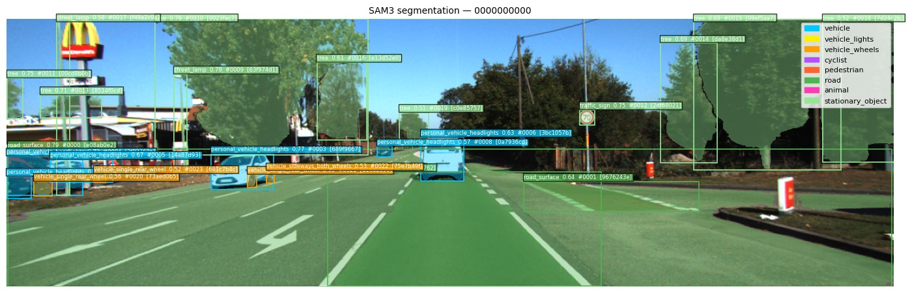
- **Stage 2:** 
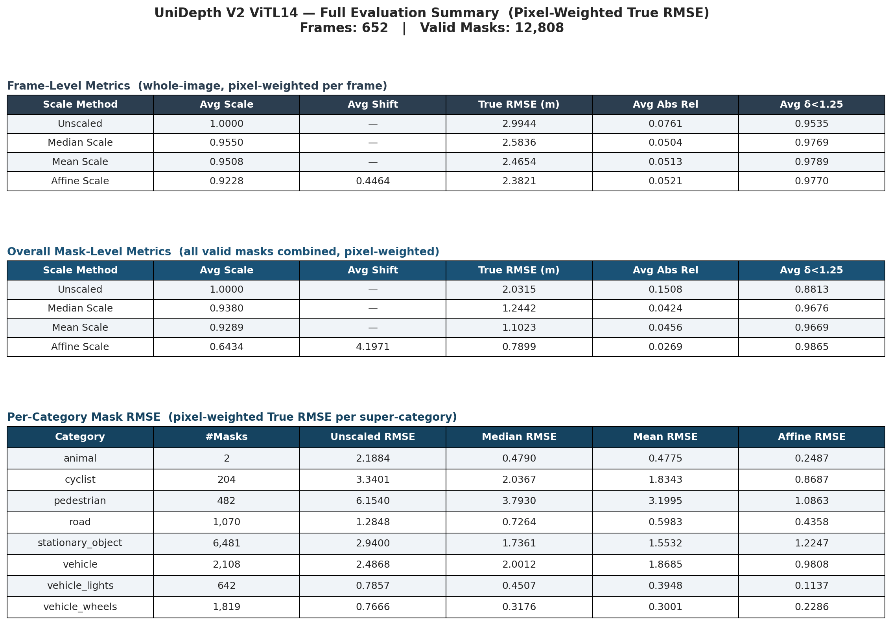
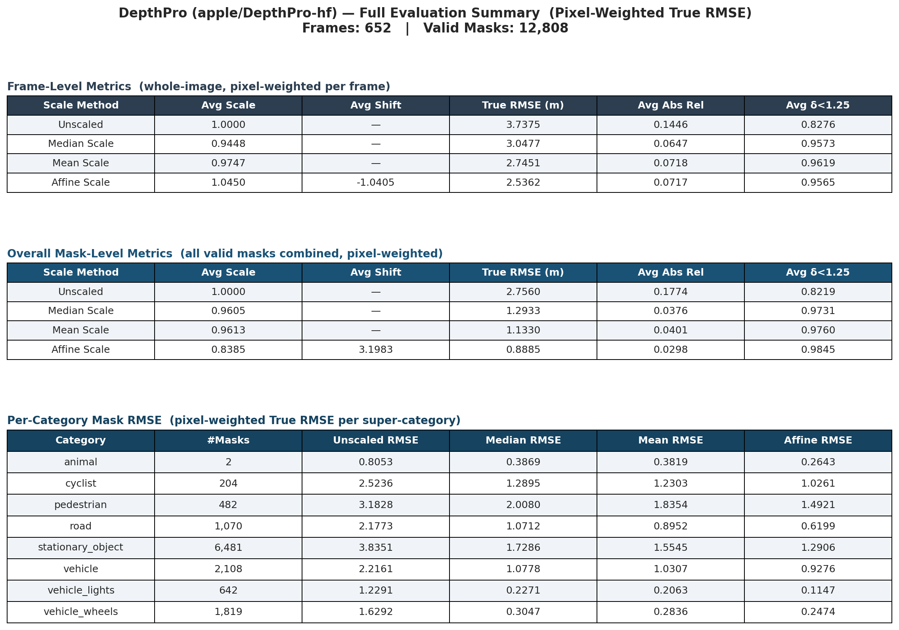
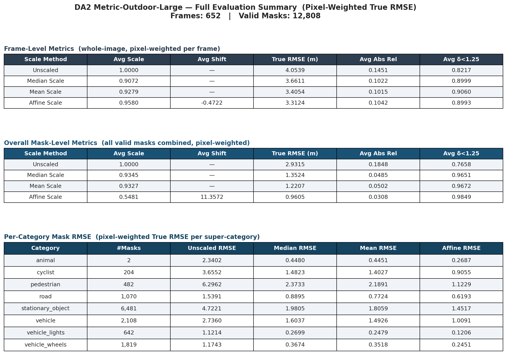
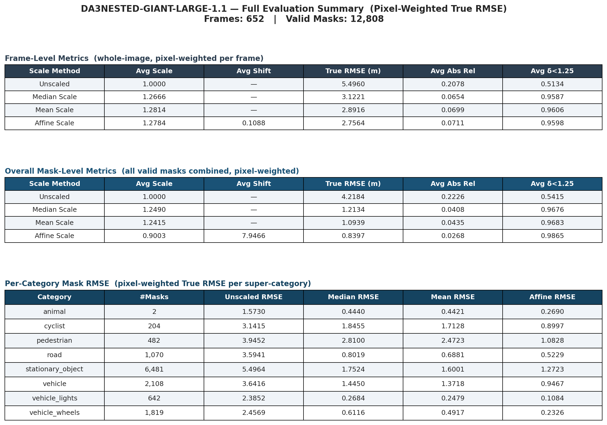
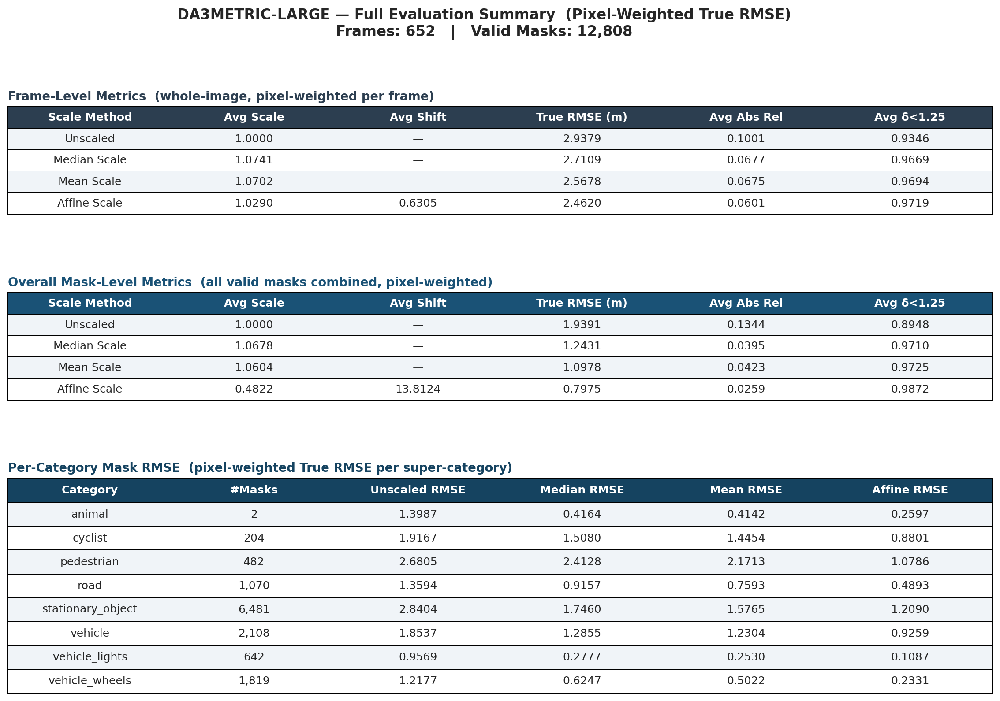
- **Stage 3:** 
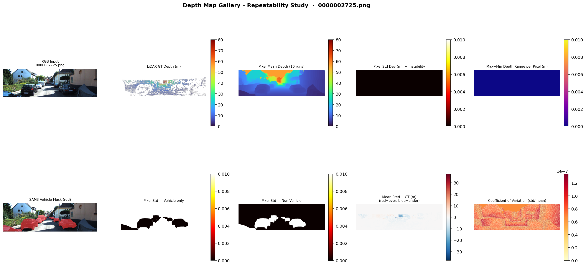
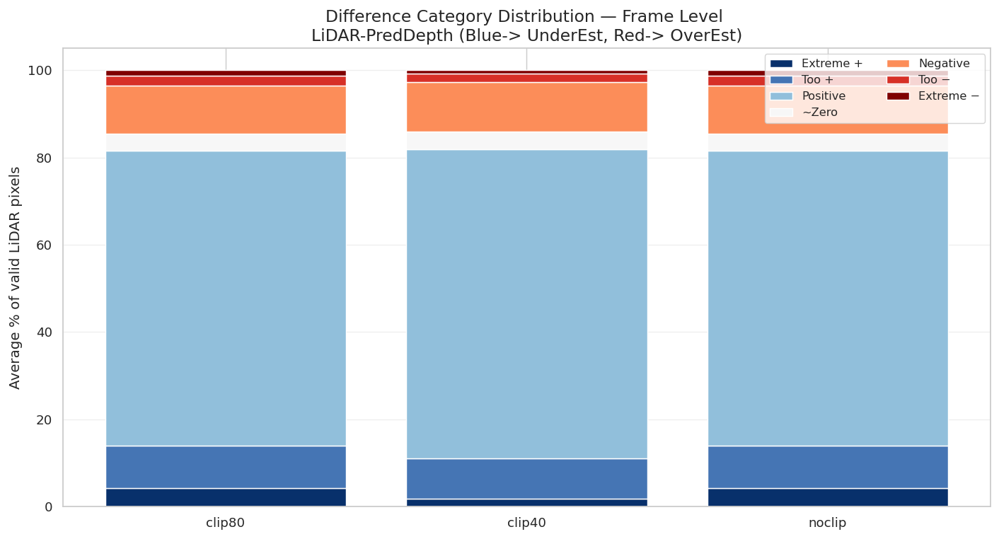
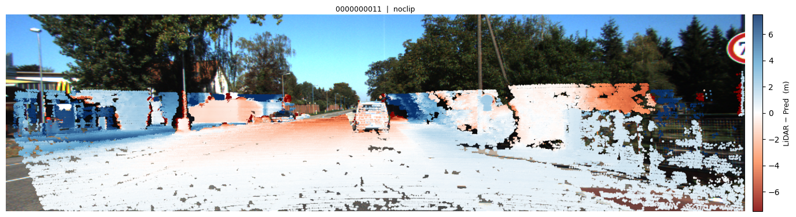
- **Stage 4:** 
> NA
- **Stage 5:** 
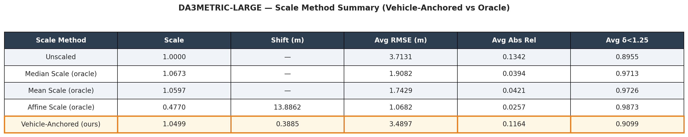
- **Stage 6:** 
> NA
- **Stage 7:** 
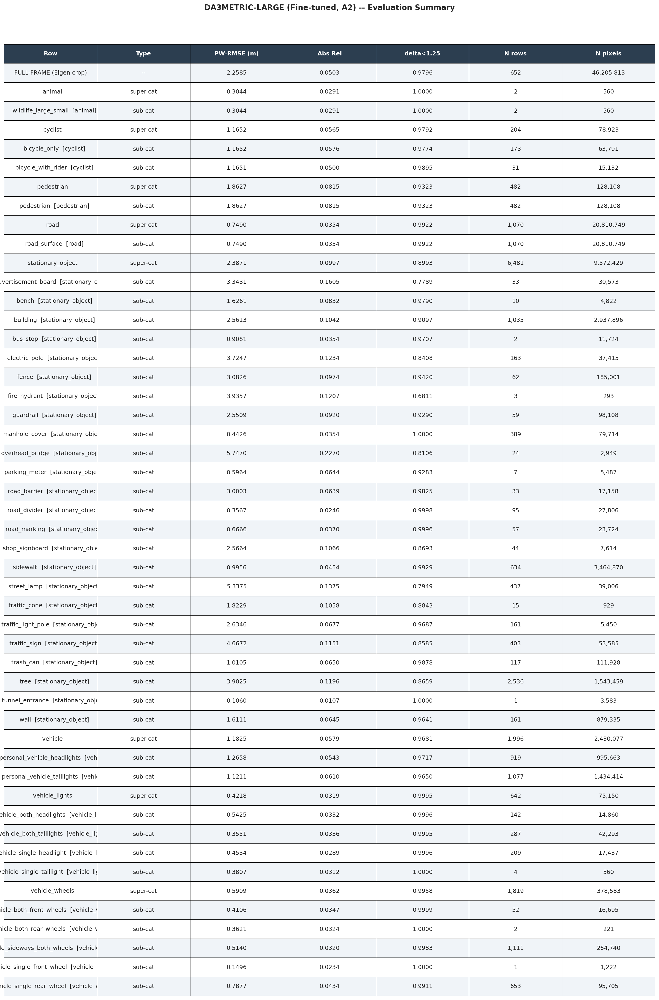
- **Stage 8:**
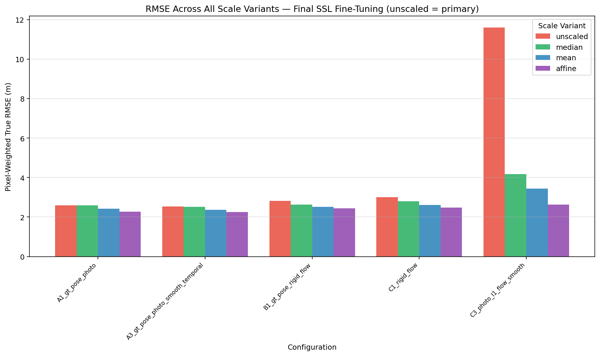
- **Stage 9:**
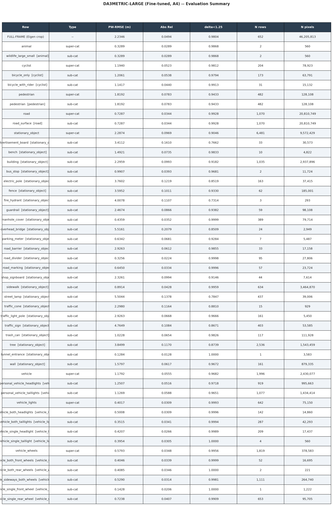

## Summary of findings

(Full detail will be in the thesis; this is just a short pointer)

- Among the zero-shot models evaluated, **Depth Anything V3 Metric-Large** performed best on KITTI Eigen-Split Dataset.
- It shows a systematic depth **underestimation within roughly 40–50 m** compared to LiDAR ground truth, but holds up for repeatability.
- A geometry-only fix (vehicle-size-anchored RANSAC + WLS scale/shift correction, no LiDAR at inference) gives only **~5% to ~6%** improvement with scale + shift correctio, which motivated moving to fine-tuning.
- The best **Fully supervised fine-tuning** on LiDAR-labelled KITTI Eigen Split Dataset gave the largest accuracy gain with RMSE of **2.25m** and is able to percieve vehicles with about **1.18m** RMSE.
- The initial results of **Self-supervised fine-tuning** gave a smaller improvement, mostly in the 40–50 m to below range. But the final results with OXTS data gave a RMSE of **2.50m**. While other loss funcitons failed to work in larger datasets but proved to work in smaller, single drive dataset.
- **Combining Self-supervised fine-tuning with Fully Supervised fine-tuning** resulted in with even further improved accuracy with RMSE of **2.23m** and is able ot percieve vehicles with about **1.17m** RMSE.

## Acknowledgements

This work builds on several open-source models and datasets (but not limited to): Segment Anything Model 3 (SAM3), UniDepth V2, DepthPro, Depth Anything V2/V3, and the KITTI Eigen Split dataset. 
Thanks to Prof. Bharat Lohani, Mr. Surya Prasath Ramalingam, Prof. Gaurav Pandey for supervision throughout this thesis. 
And Thanks to my Dear Friends and Family of thier invaluable support.
